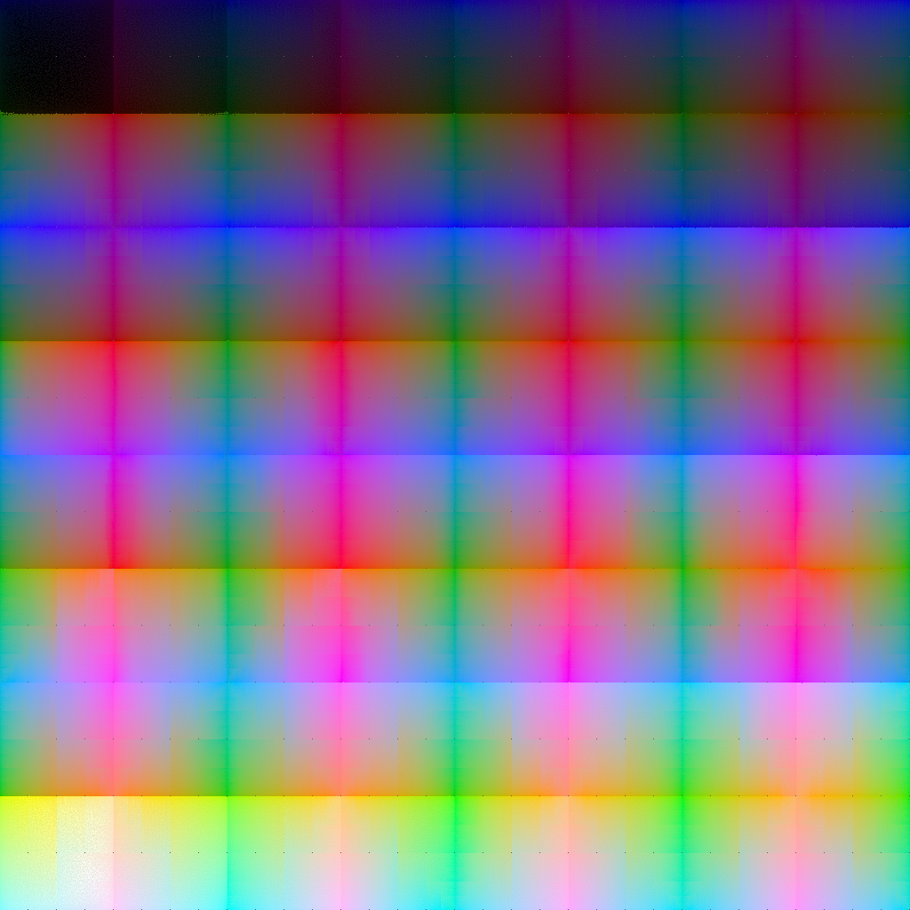
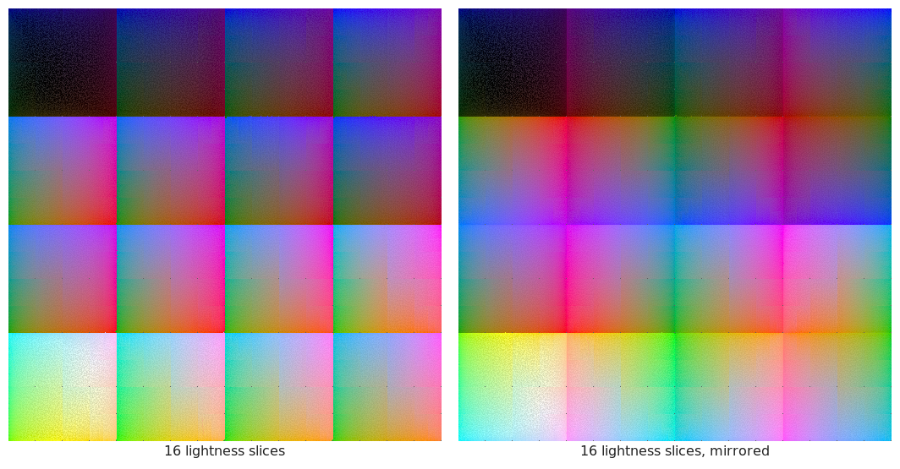
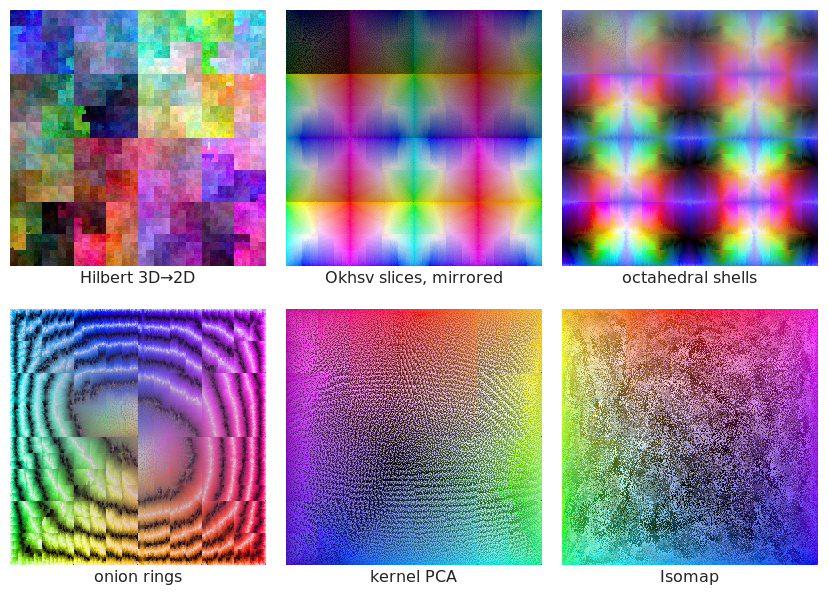

# color-codec

[](LICENSE-EUPL)
[](LICENSE-MIT)
[](LICENSE-APACHE)

This started with a hunch I couldn't (or rather: don't want to) shake: that an RGB color can be
written down with two coordinates instead of three, if one is only clever enough about it. Anchor a
spiral in the color wheel, let one number pick the position on the spiral and the other one the
lightness, and you're done. I talked it through with ChatGPT first, which agreed, wrote a spiral
codec and declared victory. Measured properly, the spiral then lost to plain Oklab quantization at
every bit rate I tested (16 to 32 bits).

So I tried something else: a bitstream in which every bit says "left" or "right", carving up the
gamut one binary decision at a time. That worked better, and on the way it led to a third design
that beats both: a lattice in Oklab that only hands out codes to colors that actually exist in
sRGB. And because I still wasn't done with the two-coordinates thing, I also tried to unfold the 3D
gamut onto a plane like a cube net. That part ends in a theorem and a penalty of at least 24% on
real images, but it produced some rather pretty maps along the way.

What's left is this pile of codecs, experiments and measurements in Rust: `f64` reference code, no
stable API, not on crates.io, so don't expect anything production-grade here. Every number below
comes from the experiments in this repository and can be regenerated with the commands given along
the way.

<p align="center">
  
</p>

*Every color the 20-bit lattice can encode, exactly once: 1,048,089 of them on a 1024×1024 grid,
unfolded as 64 mirrored lightness slices that snake from black (top left) to white (bottom left).
The horizontal lines are where this layout tears; some tear is unavoidable, as shown further down.*

TL;DR: A BCC lattice in lightness-weighted Oklab, with codes for in-gamut points only, has about
half of RGB888's error at the same 24 bits (p99 ΔE00 0.22 vs 0.45; worst case 0.34 vs 0.93).
Keeping every color within ΔE00 ≤ 1, which is about one just-noticeable difference, takes 20 bits
instead of RGB's 24. The left/right tree gets the same guarantee at about 19 bits on average as a
prefix-free, variable-length code. Flattening the gamut to two coordinates gives a usable map of
all colors, but costs at least 24% more bits on real images than plain RGB.

## What's in the box

| Codec | Module | Idea |
|---|---|---|
| `RgbQuant` | `codecs::baseline` | Uniform UNORM quantization of gamma-encoded sRGB (RGB888, RGB565, …). |
| `OklabQuant` | `codecs::baseline` | Uniform grid over the Oklab bounding box of the gamut. |
| `Spiral` | `codecs::baseline` | `(L, t)`: quantized lightness plus a position on an Archimedean spiral in the a/b plane. |
| `PerceptualKd` | `codecs::kd` | Binary partition of the sRGB cube. Each bit picks a side of a cut placed by Oklab geometry. Progressive; optional variable length with an error target. |
| `GamutLattice` | `codecs::lattice` | Cubic or BCC lattice in `(w·L, a, b)`. Only in-gamut points get codes; the code is their rank. |

### Why the tree cuts the RGB cube and not Oklab

The sRGB gamut is exactly the unit cube in RGB, so a tree that cuts the cube never wastes a code
on an impossible color. Oklab is much less tidy: only 20.8% of the gamut's Oklab bounding box is
actually inside the gamut (`cargo run --release --example gamut_fraction`), which means a plain
Oklab grid throws away 2.27 bits on every color. The tree therefore lives in RGB, but takes the
*positions* of its cuts from perceptual geometry:

- `Midpoint` cuts the axis whose longest edge has the longest Oklab chord, at the RGB midpoint.
- `Balanced` uses the same axis, but cuts where that edge's Oklab chord is halved.

The split rule is a pure function of the cell, so encoder and decoder rebuild the same tree on the
fly and nothing needs to be stored. Any prefix of a code decodes to a coarser cell. With
`Length::MaxError` the tree stops once the cell's estimated worst-case ΔE00 (the distance from its
center to the farthest corner) drops below a target, which makes the code prefix-free and
decodable from a concatenated stream (`decode_stream`).

### Why the lattice wins

The lattice keeps the useful half of each earlier idea: like the tree it spends no codes outside
the gamut, and like Oklab quantization its cells are compact and roughly round in a perceptual
space. The in-gamut points are found exactly, without sampling. Along a line of constant `L` and
`a`, every linear RGB channel is a cubic polynomial in `b`, so the in-gamut part of each lattice
column is a union of intervals between polynomial roots. That also covers the blue hues that
leave the gamut and come back in again, the case that broke the adaptive spiral.

BCC (body-centered cubic) is the best covering lattice in 3D: for a given number of points, it has
the smallest worst-case distance to the nearest one. Weighting `L` by `w = 0.4`, i.e. making
lightness coarser, matches CIEDE2000 better than raw Oklab does.

## How things were measured

CIEDE2000 (ΔE00) is the main score; the implementation passes the reference pairs from Sharma, Wu
and Dalal. The original ChatGPT conversation measured everything as Euclidean distance in Oklab
against the often-quoted "ΔE_OK ≈ 0.02 is a just-noticeable difference", but there doesn't seem to
be a peer-reviewed source for that number, so I use Oklab as a geometry here and not as a
threshold. ΔE00 ≈ 1 is the conventional JND, with measured perceptibility thresholds somewhere
around 0.8 to 1.7.

Each test set has 100,000 colors with a fixed seed: uniform in sRGB; uniform in the Oklab volume
within the gamut; dark colors (`L < 0.3`); the gamut surface (one channel at 0 or 1); and grays.
To keep the baselines honest, I picked the RGB, Oklab-grid and spiral bit splits per budget by
p99 ΔE00 on a separate calibration set. Results live in `results/` and can be regenerated with
`cargo run --release --bin study -- {fixed|var|prog|speed|lattice}`.

## Results

### Fixed rate (p99 / max ΔE00, uniform-Oklab set)

| bits | RGB (best split) | Oklab grid | Spiral | kd-ok-bal | lattice-cubic w=0.4 | lattice-bcc w=0.4 |
|---:|---:|---:|---:|---:|---:|---:|
| 16 | 2.70 / 5.77 | 2.54 / 3.77 | 3.08 / 5.18 | 2.29 / 4.78 | 1.48 / 2.64 | 1.41 / 2.85 |
| 20 | 1.14 / 2.34 | 0.97 / 1.36 | 1.15 / 1.79 | 0.91 / 1.86 | 0.58 / 0.85 | 0.55 / 0.86 |
| 24 | 0.45 / 0.93 | 0.41 / 0.60 | 0.48 / 0.65 | 0.38 / 0.74 | 0.23 / 0.40 | 0.22 / 0.34 |
| 28 | 0.16 / 0.38 | 0.16 / 0.24 | 0.19 / 0.33 | 0.14 / 0.27 | 0.09 / 0.14 | 0.09 / 0.14 |
| 32 | 0.069 / 0.139 | 0.061 / 0.088 | 0.072 / 0.115 | 0.057 / 0.107 | 0.036 / 0.054 | 0.034 / 0.056 |

All five test sets are in `results/fixed.md`; uniform-sRGB, dark and surface colors give the same
ranking. Grays are the exception. RGB keeps grays exactly neutral, while the tree and the lattice
put gray inputs into cells whose centers carry a little chroma, and ΔE00 is rather touchy about
chroma near neutral. At 24 bits, the gray p99 is 0.18 for RGB, 0.18 for the BCC lattice and 0.67 for
the tree.

### Bits needed to guarantee a worst case (observed over 100k colors)

| target | dataset | RGB | Oklab grid | lattice-bcc w=0.4 | kd-ok-bal variable (mean / max) |
|---|---|---:|---:|---:|---:|
| ΔE00 ≤ 2 | uniform-sRGB | 21 | 20 | 17 | 15.7 / 21 |
| ΔE00 ≤ 1 | uniform-sRGB | 24 | 22 | 20 | 18.6 / 24 |
| ΔE00 ≤ 1 | dark | 25 | 22 | 20 | 19.5 / 24 |
| ΔE00 ≤ 1 | gray | 18 | 18 | 20 | 23.1 / 24 |
| ΔE00 ≤ 0.5 | uniform-sRGB | 26 | 25 | 23 | 21.6 / 27 |

The variable-length tree's own error bound held for every color: 0 of 1.5M samples went over the
target.

### Progressive decoding (tree, 32-bit codes)

| codec | p99 ΔE00 after 12 / 16 / 20 / 24 bits | refinements that make a color worse |
|---|---:|---:|
| kd-rgb (plain RGB halving) | 7.13 / 3.43 / 1.18 / 0.45 | 29.2% |
| kd-ok-bal | 6.18 / 2.30 / 0.92 / 0.38 | 28.1% |

Every extra bit shrinks the cell, but about 28% of single-bit refinements move the reconstruction
slightly *away* from the true color. Only the uncertainty bound shrinks monotonically. That is a
property of midpoint reconstruction in general and not a bug of this particular tree; the ChatGPT
experiments had seen the same thing, at about 25%.

### Speed (single thread, unoptimized)

| codec | encode | decode | tables |
|---|---:|---:|---:|
| RGB 11/11/10 | 25 ns | 5 ns | none |
| lattice-bcc 24-bit | 168 ns | 209 ns | 2.5 MiB |
| lattice-bcc 32-bit | 442 ns | 1.3 µs | 101 MiB |
| kd-ok-mid 32-bit | 15 µs | 15 µs | none |
| kd-ok-bal 32-bit | 71 µs | 73 µs | none |

The balanced tree pays for a 16-step bisection at every node. The lattice tables are plain
run-length columns and could be packed far tighter.

## Things that didn't work (and a few that did)

The spiral was the original idea, and it does work in the sense that two numbers can describe
every color. It is worse than plain Oklab quantization at every bit rate tested, which in
hindsight makes sense: two coordinates were never the constraint, bits are, and any finite code is
a single integer anyway. What matters, in that order, is not wasting codes on impossible colors
(the Oklab grid spends 79% of its codes outside the gamut) and getting the shape of the cells
right. The tree's cuts are aligned with the RGB axes, which sit at an angle to the perceptual
ones, so its cells come out sheared in Oklab. Reweighting the tree's geometry didn't close that
gap.

Oklab's behavior near black looked like the next suspect, since its cube root has an infinite slope
at zero. Ottosson's `L_r` toe and CIELAB both seemed like obvious fixes for the tree's split
geometry, and both made things *worse* under ΔE00, dark colors included
(`results/fixed_geometries.md`). Well, well. What did help was the opposite direction: raw Oklab
over-weights lightness compared to CIEDE2000, and the lattice improves steadily from `w = 1` down
to `w ≈ 0.4` (`results/lattice_sweep.md`).

Finally, BCC beats the plain cubic lattice by less than theory promises. With covering
thicknesses of 1.4635 (BCC) and 2.7207 (cubic), the covering radius at equal point density should
drop by about 19%. Under ΔE_OK at `w = 1`, the measured p99 drops by about 13% and the maximum by
only 3 to 9% (`cargo run --release --example bcc_vs_cubic`). The likely reason, not yet verified,
is the gamut boundary: the maximum is set by colors near it, whose nearest *in-gamut* point is
farther away than the lattice spacing suggests.

## Two coordinates, revisited: unfolding the gamut

Having made peace with bits being the real currency, I still wanted to know whether the gamut can
be unfolded onto a plane like a cube net, and whether that would buy anything: fewer bits, better
image compression, or at least a good 2D map of all colors.

The math is clear on the first point. A cube's *surface* is 2D, so it unfolds; the gamut is a
*volume*, and there is no continuous one-to-one map from R³ into R² (invariance of domain). Every
flattening has to tear the volume somewhere, Borsuk–Ulam guarantees that any continuous map of a
sphere-like shell into the plane merges some pair of opposite colors, and space-filling curves are
at best 1/d-Hölder. Quantized, any set of points fits any number of coordinates (the lattice rank
already is a single one), so a 2D layout of the same lattice needs exactly the same `log2(N)` bits.
What a layout *can* change is locality, and that is what the experiments measure.

`src/flat/` builds bijective layouts of the 20-bit (1024²) and 16-bit (256²) BCC lattices. Each
method gives every point a 2D target position, and recursive median bisection then fills the grid
evenly.

| layout | idea |
|---|---|
| raster | rank in row-major order (control) |
| Morton / Hilbert 3D→2D | sort points along a 3D curve, lay the sequence along the 2D curve |
| L-slices | 3D-LUT style atlas: lightness slabs as tiles, (a, b) inside |
| Okhsv slices | Ottosson's exact gamut-to-cylinder mapping; value slabs as tiles, hue/saturation disk inside |
| shells-octa | onion shells around the gamut's centroid, each unfolded with the equal-area octahedral map |
| onion rings | shells as annuli of one disk; elevation alternates direction per shell so neighboring shells meet at the same pole |
| kernel PCA / Isomap | RBF kernel PCA and landmark Isomap embeddings (1500 landmarks) |

"Mirrored" means every other tile is flipped, so that touching edges of consecutive tiles show
matching colors, which is the trick that makes a cube net fold back together. The onion shells are
well defined because the gamut is star-shaped around the Oklab centroid of the lattice points: not
a single point lies beyond the first gamut exit of its ray.

Here is the 18-bit lattice cut into 16 lightness slices, once as a plain atlas and once mirrored.
On the right, neighboring tiles meet at matching colors along their vertical edges. The horizontal
edges between rows still tear, because the tile below is several slabs further along in lightness;
mirroring can hide some seams, but not all of them.



### Locality

| layout (20-bit) | adjacent-cell ΔE00 mean / p99 | visible seams (ΔE00 > 5) | near twins > 4 cells apart |
|---|---:|---:|---:|
| raster | 13.5 / 75.7 | 48.9% | 78% |
| Hilbert 3D→2D | 1.48 / 12.4 | 3.8% | 43% |
| L-slices 16 | 1.83 / 8.0 | 2.9% | 26% |
| L-slices 64 mirrored | 0.85 / 3.8 | 0.66% | 35% |
| Okhsv slices 64 mirrored | 0.98 / 6.0 | 1.3% | 45% |
| shells-octa 16 mirrored | 1.20 / 8.5 | 2.6% | 39% |
| onion rings 8 | 2.67 / 18.4 | 13% | 65% |

| 16-bit layout | trustworthiness / continuity (Venna & Kaski, k = 10) |
|---|---:|
| L-slices mirrored | 0.998 / 0.955 |
| Hilbert | 0.984 / 0.959 |
| kernel PCA | 0.896 / 0.998 |
| Isomap | 0.907 / 0.997 |

"Near twins" are two colors one lattice step apart. The kernel methods keep color neighbors
together but pile unrelated colors next to each other: they recover hue and chroma and crush
lightness into speckle, and 67 to 77% of their adjacent cells are visible seams. Exactly what
invariance of domain predicts, though it is still something to see it happen:



Hilbert's blocks are the curve's recursion showing through, and the octahedral shells come out as
a grid of pinwheels, one per shell. The onion rings would be rather lovely if it weren't for the
poles: consecutive shells do meet continuously at their shared pole, but the dark, noisy bands are
the dark pole of every other shell, smeared around the full circle because azimuth is undefined
there. That smearing is where this layout tears.

### Images

For the compression test I used the 13 wallpapers that happened to be in `/usr/share/backgrounds`,
resized to 1024 px wide and quantized to the 20-bit lattice (p99 ΔE00 0.2 to 0.7). Two of them
produced identical numbers and are most likely the same picture under two names. Mean bits per
pixel, all for the *same* quantized image:

| encoding | bpp |
|---|---:|
| RGB888 → WebP lossless | 3.36 |
| RGB888 → Paeth + zstd (same coder as the layouts) | 4.80 |
| 1-D lattice rank → zstd | 5.31 |
| best 2D layout (Okhsv slices mirrored) → Paeth + zstd | 5.95 |
| L-slices mirrored → Paeth + zstd | 6.03 |
| Hilbert 3D→2D → Paeth + zstd | 6.39 |
| raster → Paeth + zstd | 7.92 |

Averaging the codes of neighboring pixels, as a GPU's texture filter would, gives a color more
than ΔE00 2 off the true blend for 0% of pairs with RGB888, 41% with Hilbert, 46% with the
L-slices and 70% with the onion rings.

### Verdict

Flattening doesn't buy fewer bits. The per-color budget is set by how many colors need to be told
apart, not by how many coordinates carry them, and on images every 2D layout costs at least 24%
more than plain RGB888 under the same coder. The reason is continuity: natural images vary
smoothly, and RGB, like any continuous three-coordinate system, keeps gradients smooth in every
channel. A 2D layout has to tear, and every tear a gradient crosses turns into an expensive
residual. Squeezing out a dimension trades one coordinate for a lot of discontinuities.

The maps, on the other hand, turned out genuinely useful (and rather pretty). The mirrored L-slice
atlas shows every one of the 1,048,089 in-gamut lattice colors exactly once, with visible seams on
only 0.66% of adjacent cells, and mirroring alone cut the p99 seam of the 16-bit map from ΔE00 43
to 9.9. All 256² renders are in `results/maps/`. The experiments run with
`cargo run --release --bin flat -- {layouts|images}`, and the figures in this README come from
`cargo run --release --bin flat -- maps`; the WebP numbers and the figure labels need ImageMagick
(with libwebp for the former).

## Prior art

- **Fibonacci-lattice color quantization**, Mojsilović & Soljanin (SPIE 2000, IEEE TIP 2001): a
  fixed, image-independent codebook from spiral lattices in Lab. It is the closest prior work to a
  universal perceptual color code, and, amusingly, to the spiral idea. It is neither binary nor
  progressive.
- **Tree-structured and entropy-constrained VQ** (Chou, Lookabaugh & Gray 1989; Riskin & Gray
  1991), plus median cut, octree, Wu and Orchard–Bouman for palettes. All of these adapt to an
  image. I found no fixed, Oklab-guided k-d partition of the whole sRGB gamut used as a progressive
  universal color code, which is absence of evidence and not proof.
- **Tree-VQ** (Ma et al., arXiv:2609.03641, September 2026): progressive, prefix-decodable trees
  over learned image tokens rather than single colors.
- **JNDs:** ITU-R BT.2124 (ΔE_ITP = 1 ≈ JND); Dolby's PQ and ICtCp bit-depth work (10-bit ICtCp ≈
  11.5-bit YCbCr); Björn Ottosson's Oklab and color picker posts (the `L_r` toe and Okhsv).
- **Unfolding:** octahedral normal encoding (Cigolle et al., JCGT 2014), equal-area octahedral
  mapping (Clarberg, JGT 2008), Hilbert curve locality (Moon et al., TKDE 2001).

## Limitations

- The codec study uses synthetic color sets; only the flattening study looked at real images, and
  those were wallpapers rather than a standard set such as Kodak.
- ΔE00 stands in for perception. No viewing study was run.
- "Bits needed" counts are observed maxima over 100k samples, not proofs. The tree's corner-radius
  bound is an estimate too, though it held in every sample.
- I tuned `w = 0.4` once, at 20 bits, on the evaluation seed. The margins it produces are much
  larger than its sensitivity, but a clean held-out tuning is still on the list.

## What's next

- A progressive lattice: order the lattice ranks hierarchically, e.g. with a gamut-only binary
  partition of the lattice points, to combine the lattice's quality with the tree's prefix
  decoding and variable length.
- Fixing the grays: put a lattice coset on the neutral axis, or snap near-neutral reconstructions.
- Smaller tables: one `(k0, k1, rank)` per column plus a short exception list, or columns computed
  on the fly with the cubic-root solver.
- Entropy-coding lattice ranks or tree paths over real photos and comparing against RGB888, WebP
  lossless, RGB9E5 and R11G11B10F.

## Layout

```
src/color.rs            sRGB / linear / Oklab / CIELAB conversions (f64)
src/metric.rs           ΔE_OK, CIEDE2000 (Sharma reference tests)
src/code.rs             Code (≤64-bit MSB-first bit string), Codec trait
src/codecs/baseline.rs  RGB, Oklab-grid and spiral codecs
src/codecs/kd.rs        perceptual binary partition (fixed / variable length, streams)
src/codecs/lattice.rs   gamut-ranked cubic / BCC lattices with exact cubic-root columns
src/data.rs             seeded test color sets
src/stats.rs            summaries, parallel evaluation
src/flat/               2D layouts: Hilbert/Morton, slice atlases, Okhsv, octahedral shells,
                        onion rings, kernel PCA / Isomap, locality metrics, plane coding
src/bin/study.rs        codec experiments; writes markdown and results/fixed.csv
src/bin/flat.rs         flattening experiments; writes results/flat_*.md and results/maps/
examples/               in-gamut share of the Oklab box, BCC vs. cubic comparison
docs/images/            README figures (`flat -- maps`)
```

## License

Licensed under either of [European Union Public License, Version 1.2](LICENSE-EUPL),
[Apache License, Version 2.0](LICENSE-APACHE) or [MIT license](LICENSE-MIT) at your option.

Have fun, take care!
